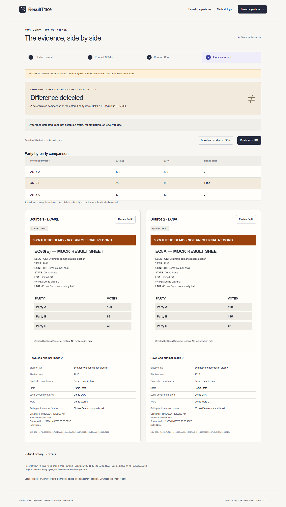

# ResultTrace

**Two documents. One clearer picture.** An independent observation aid for comparing human-confirmed party vote figures in a publicly displayed EC60(E) poster and a corresponding, lawfully obtained EC8A image.

> **Difference detected does not establish fraud, manipulation, or legal validity.**

Built for **Every Vote, Every Voice**, assigned repository **ktechfest2/TEAM-17-3.0**. AI coding assistance: **Yes — Codex**. This is not INEC, IReV, BVAS, an official collation system, a voting platform or a fraud detector.

## Run locally

Use Node.js 22 and npm.

```sh
npm ci
npm run dev
```

Open http://localhost:3000. No API key or database is needed for the entire manual flow. Use a synthetic demo from the start screen, or upload the clearly marked PNGs in `public/demo/`.

```sh
npm run lint
npm run typecheck
npm test
npm run build
npx playwright install chromium
npm run test:e2e
```

If Chrome is already installed, PowerShell users can set `$env:PLAYWRIGHT_CHANNEL = 'chrome'` before running browser tests. Tests run against a production build, so run `npm run build` first. For a production local server, run `npm run start`.

## Implemented

- Separate election title/year, contest/constituency, state, LGA, ward and polling-unit identifiers for both sources.
- JPEG, PNG and WebP image upload/mobile capture, 8 MB limit, magic-byte validation, compressed preview, original preservation, SHA-256 fingerprint, and 180° view-only rotation.
- Editable manual party rows; explicit human confirmation; all source edits clear confirmation.
- Pure deterministic comparator: **Match**, **Difference detected**, **Insufficient evidence**, plus an identity-conflict blocking state. Delta is EC8A minus EC60(E).
- Unknown counts stay unknown. Missing parties prevent Match. Party normalization changes only case/whitespace; equivalent abbreviations must be explicitly edited by a human.
- IndexedDB draft/report persistence, saved-state indicators, local history and explicit deletion.
- Offline editing and saving while the application is already open. Refresh/reopening works when online; **fresh offline navigation is not supported**.
- Report with both source previews, original downloads, per-source identifiers, timestamps, confirmations, hashes and audit events. Print/save PDF or download JSON including original images and before/after review snapshots.
- Four visibly synthetic demo scenarios: match, +100 difference, identity conflict, unreadable count.
- Optional server-only OpenAI adapter with strict structured output, Zod validation, request/image bounds, timeout, explicit upload consent, and manual fallback.

## Screenshots




Mobile review: [screenshot](docs/screenshots/review-mobile.png). Printable example: [synthetic report PDF](docs/screenshots/synthetic-evidence-report.pdf).

## Optional extraction

Copy `.env.example` to `.env.local`, set `OCR_ENABLED=true`, and configure `OPENAI_API_KEY` on the server. `OPENAI_VISION_MODEL` defaults to `gpt-4.1-mini`. Never use `NEXT_PUBLIC_` for credentials. Restart the server after changing environment variables.

Extraction sends a compressed derivative to OpenAI only after the user consents and presses the extraction button. Original evidence remains local. Provider results are unconfirmed suggestions, not evidence of authenticity. Confidence is qualitative, not a calibrated probability. The adapter uses Responses API structured output with `store:false`; this is not a claim of zero provider retention. Review provider data controls before using real documents.

**No live provider call has been verified in this build because no API credential was configured.** Unit tests use mocked provider responses and cover invalid output and failure states. Public demo extraction remains disabled. Before enabling paid extraction publicly, add platform rate/access limits and a provider budget. The same-origin request check is not authentication or distributed rate limiting.

## Architecture and integrity

Next.js App Router + React + TypeScript; Tailwind CSS with a small custom visual system; Zod for count/extraction validation; `idb` for IndexedDB; Lucide icons. No paid database, cloud sync, login, analytics or official results API.

- `src/lib/model.ts`: pure identity/party normalization, count validation, comparison engine.
- `src/lib/images.ts`: safe-format checks, preview generation and original hashing.
- `src/lib/storage.ts`: browser-local persistence.
- `src/components/`: workflow, source review and evidence report.
- `src/lib/server/extraction.ts` and `src/app/api/extract/route.ts`: isolated optional provider boundary.

Audit events record entered values and confirmation changes locally. They are **not tamper-proof**; browser tools can modify local data. Hashes identify image bytes, not genuine photographs. Replacing an image retains its old hash in the audit but the old original must be downloaded separately before replacement. A Match covers the reviewed rows only; the user must check that all source parties are included. Unknown identifiers cannot be overridden into a match: correct them explicitly and reconfirm.

Browser data clearing, eviction, private browsing or device loss may erase records. Data is tied to this browser and origin; localhost records do not automatically appear on a deployed URL. Download important reports. JSON export is archival; there is no import/restore UI. No service worker or installable-PWA claim. No crop, localization, USSD/SMS, cloud collaboration or certified chain of custody is implemented.

## Deployment and repository

Source branch: [`codex/resulttrace`](https://github.com/ktechfest2/TEAM-17-3.0/tree/codex/resulttrace). The remote was empty; GitHub made the first pushed branch its default. No teammate history was overwritten and no force push was used. There was no separate base branch for a meaningful PR.

**Deployment blocked:** Vercel project creation returned HTTP 403, “You don't have permission to create the project,” for `resulttrace` in `elijah-ntans-projects`. No live demo URL has been verified. See [deployment steps](docs/DEPLOYMENT.md).

## Documentation

[Problem brief](docs/PROBLEM_BRIEF.md) · [System sketch](docs/SYSTEM_SKETCH.md) · [Project write-up](docs/PROJECT_WRITEUP.md) · [Demo script](docs/DEMO_SCRIPT.md) · [Submission checklist](docs/SUBMISSION_CHECKLIST.md) · [Verification](docs/VERIFICATION.md)

## Sources and credits

- [INEC 2022 regulations and guidelines](https://wp1.inecnigeria.org/wp-content/uploads/2022/06/REGULATIONS-AND-GUIDELINES-FOR-THE-CONDUCT-OF-ELECTIONS-2022_updtd.pdf), historical source supplied in the brief. Retrieval returned 502 during this build; the referenced paragraphs were not independently verified. No assertion that it governs every current/future election.
- [Next.js documentation](https://nextjs.org/docs/app/getting-started/installation), [React](https://react.dev/), [Tailwind CSS](https://tailwindcss.com/), [Zod](https://zod.dev/), [idb](https://github.com/jakearchibald/idb), [Lucide](https://lucide.dev/), [Vitest](https://vitest.dev/), [Playwright](https://playwright.dev/), [Prettier](https://prettier.io/).
- [OpenAI vision guide](https://developers.openai.com/api/docs/guides/images-vision), [structured outputs](https://developers.openai.com/api/docs/guides/structured-outputs), [GPT-4.1 mini](https://developers.openai.com/api/docs/models/gpt-4.1-mini): consulted for the optional adapter.
- Synthetic documents are generated with browser canvas, with no INEC logo, official seal or real voter data. No AI image generator was used.

Original application code was created in this session on 2026-11-19. The organizer’s actual 48-hour eligibility window must be confirmed by the team. No project license was chosen without team/organizer agreement; dependencies retain their own licenses.
