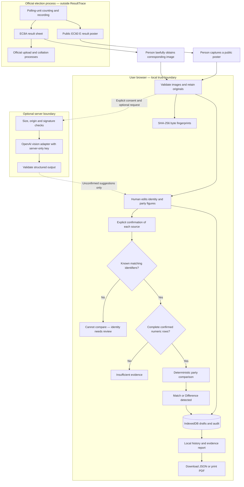

# System sketch and trust boundaries

This is a conceptual domain sketch, not a current legal interpretation. The supplied INEC 2022 reference could not be retrieved during this build.

There is no ResultTrace connection to IReV or to official collation. Source authenticity is unverified. Human confirmation establishes a reviewed transcription, not a verified election result. Hashes show byte identity only. Local audit events can be modified outside the app. The optional provider receives a compressed image, not the local original; it is disabled by default.
